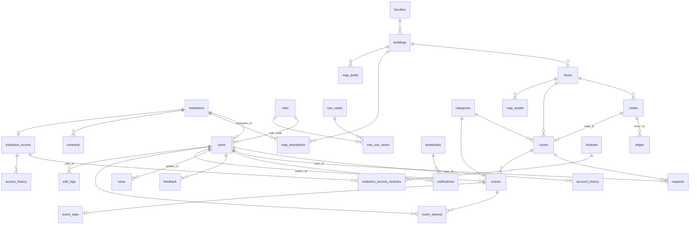

# SciMap — Master Database Schema

Authoritative description of the PostgreSQL 16 schema defined in [`schema.sql`](schema.sql). If the two disagree, `schema.sql` wins; update this file whenever you change it.

- **33 tables** + 1 view (`event_stats_view`), all in the `public` schema
- Primary keys are `TEXT` ids (e.g. `U001`, `ND-0010`, `INST-01`) unless noted; association tables use composite keys
- Column names are `snake_case`; the backend (`backend/src/pg.js`) maps them to `camelCase`
- Seed data lives in `seed/*.json` (one file per table); `seed.sql` is generated by `scripts/build-seed.js`
- Changes to an existing database go in `migrations/` (see [Change history](#change-history))

## Contents

1. [Entity relationships](#entity-relationships)
2. [Users and access](#1-users-and-access)
3. [Buildings and map](#2-buildings-and-map)
4. [Requests, notifications, feedback](#3-requests-notifications-feedback)
5. [News and events](#4-news-and-events)
6. [Marketing](#5-marketing)
7. [Audit and statistics](#6-audit-and-statistics)
8. [Delete behaviour](#delete-behaviour-summary)
9. [Change history](#change-history)
10. [Maintenance rules](#maintenance-rules)

## Entity relationships

`edit_logs` additionally references 13 target tables (see [§6](#edit_logs)); they are omitted from the diagram for readability.

## 1. Users and access

### institutions
Organisations that use the system.

| Column | Type | Constraints |
|---|---|---|
| `id` | TEXT | PK |
| `name` | TEXT | NOT NULL, UNIQUE |
| `short_name` | TEXT | |
| `contact_email` | TEXT | |
| `created_at` | TIMESTAMPTZ | NOT NULL, default `now()` |

### roles
| Column | Type | Constraints |
|---|---|---|
| `code` | TEXT | PK (e.g. `user`, `exec`, `marketing`, `gis`, `admin`, `pr`, `registrar`) |
| `name` | TEXT | NOT NULL |

### use_cases
Menu entries / features shown in the UI.

| Column | Type | Constraints |
|---|---|---|
| `key` | TEXT | PK |
| `title` | TEXT | NOT NULL |
| `icon` | TEXT | |
| `sort_order` | INTEGER | NOT NULL, default 0 |

### role_use_cases
Which menus each role sees (many-to-many).

| Column | Type | Constraints |
|---|---|---|
| `role_code` | TEXT | PK part, FK → `roles(code)` ON UPDATE CASCADE, ON DELETE CASCADE |
| `use_case_key` | TEXT | PK part, FK → `use_cases(key)` ON UPDATE CASCADE, ON DELETE CASCADE |

### users
| Column | Type | Constraints |
|---|---|---|
| `id` | TEXT | PK |
| `email` | TEXT | NOT NULL, UNIQUE |
| `password_hash` | TEXT | NOT NULL (bcrypt) |
| `name` | TEXT | NOT NULL |
| `username` | TEXT | UNIQUE |
| `role_code` | TEXT | NOT NULL, default `'user'`, FK → `roles(code)` ON UPDATE CASCADE |
| `institution_id` | TEXT | FK → `institutions(id)` |
| `status` | TEXT | NOT NULL, default `'active'`, CHECK in (`active`, `suspended`) |
| `created_at` | TIMESTAMPTZ | NOT NULL, default `now()` |

### account_history
Audit trail for account changes made by admins.

| Column | Type | Constraints |
|---|---|---|
| `id` | TEXT | PK |
| `user_id` | TEXT | NOT NULL, FK → `users(id)` ON DELETE CASCADE |
| `changed_by` | TEXT | FK → `users(id)` ON DELETE SET NULL |
| `action` | TEXT | NOT NULL, CHECK in (`SUSPENDED`, `RESTORED`, `ROLE_CHANGED`) |
| `old_value`, `new_value`, `reason` | TEXT | |
| `changed_at` | TIMESTAMPTZ | NOT NULL, default `now()` |

## 2. Buildings and map

### faculties
| Column | Type | Constraints |
|---|---|---|
| `id` | TEXT | PK |
| `name` | TEXT | NOT NULL, UNIQUE |

### buildings
| Column | Type | Constraints |
|---|---|---|
| `id` | TEXT | PK |
| `faculty_id` | TEXT | FK → `faculties(id)` |
| `code` | TEXT | NOT NULL, UNIQUE (e.g. `SC8`) |
| `name` | TEXT | NOT NULL |
| `outline`, `bounds` | JSONB | geometry used by the map |

### floors
| Column | Type | Constraints |
|---|---|---|
| `id` | TEXT | PK |
| `building_id` | TEXT | NOT NULL, FK → `buildings(id)` ON DELETE CASCADE |
| `floor_no` | TEXT | NOT NULL |
| `name`, `svg`, `note` | TEXT | `svg` holds the floor-plan drawing |
| `status` | TEXT | NOT NULL, default `'draft'`, CHECK in (`draft`, `published`) |

UNIQUE (`building_id`, `floor_no`).

### nodes
Navigation graph vertices.

| Column | Type | Constraints |
|---|---|---|
| `id` | TEXT | PK |
| `node_key` | TEXT | NOT NULL, UNIQUE (stable legacy key) |
| `floor_id` | TEXT | NOT NULL, FK → `floors(id)` ON DELETE CASCADE |
| `name` | TEXT | |
| `type` | TEXT | NOT NULL |
| `x`, `y` | DOUBLE PRECISION | NOT NULL, floor-plan coordinates |

### edges
Navigation graph connections (undirected in use; stored once).

| Column | Type | Constraints |
|---|---|---|
| `id` | TEXT | PK |
| `from_node_id`, `to_node_id` | TEXT | NOT NULL, FK → `nodes(id)` ON DELETE CASCADE |
| `distance` | DOUBLE PRECISION | |
| `edge_type` | TEXT | NOT NULL, default `'walk'`, CHECK in (`walk`, `stairs`, `elevator`, `ramp`, `exterior`) |
| `accessible` | BOOLEAN | NOT NULL, default `true` |

CHECK `from_node_id <> to_node_id`. Cross-floor edges join nodes on different floors.

### categories
Place/event categories.

| Column | Type | Constraints |
|---|---|---|
| `id` | TEXT | PK |
| `name` | TEXT | NOT NULL |
| `kind` | TEXT | NOT NULL |
| `color` | TEXT | |
| `desc` | TEXT | quoted identifier `"desc"` (reserved word) |

### room_types
Managed by the registrar; icon may be an emoji or a base64 `image/png` data URL.

| Column | Type | Constraints |
|---|---|---|
| `id` | TEXT | PK |
| `name` | TEXT | NOT NULL, UNIQUE |
| `icon` | TEXT | NOT NULL, default `'🏫'` |
| `color` | TEXT | NOT NULL, default `'#1A73E8'` |
| `description` | TEXT | |
| `created_at` | TIMESTAMPTZ | NOT NULL, default `now()` |

### rooms
| Column | Type | Constraints |
|---|---|---|
| `id` | TEXT | PK |
| `floor_id` | TEXT | NOT NULL, FK → `floors(id)` ON DELETE CASCADE |
| `node_id` | TEXT | UNIQUE, FK → `nodes(id)` ON DELETE SET NULL (one room per node) |
| `category_id` | TEXT | FK → `categories(id)` |
| `code` | TEXT | NOT NULL |
| `name`, `type`, `teacher` | TEXT | `type` is a free-text label matching `room_types.name` (not an FK) |
| `capacity` | INTEGER | CHECK null or ≥ 0 |
| `created_at` | TIMESTAMPTZ | NOT NULL, default `now()` |

UNIQUE (`floor_id`, `code`).

### map_boundaries
| Column | Type | Constraints |
|---|---|---|
| `id` | TEXT | PK |
| `building_id` | TEXT | FK → `buildings(id)` ON DELETE CASCADE |
| `institution_id` | TEXT | FK → `institutions(id)` ON DELETE SET NULL |
| `name` | TEXT | NOT NULL |
| `type` | TEXT | |
| `geometry` | JSONB | |
| `status` | TEXT | NOT NULL, default `'draft'` |
| `updated_at` | TIMESTAMPTZ | NOT NULL, default `now()` |

### map_assets
| Column | Type | Constraints |
|---|---|---|
| `id` | TEXT | PK |
| `floor_id` | TEXT | FK → `floors(id)` ON DELETE CASCADE |
| `name` | TEXT | NOT NULL |
| `kind`, `file` | TEXT | |
| `status` | TEXT | NOT NULL, default `'draft'` |
| `updated_at` | TIMESTAMPTZ | NOT NULL, default `now()` |

### map_drafts
Saved editor snapshots from the GIS panel.

| Column | Type | Constraints |
|---|---|---|
| `id` | TEXT | PK |
| `building_id` | TEXT | FK → `buildings(id)` ON DELETE CASCADE |
| `saved_by` | TEXT | FK → `users(id)` ON DELETE SET NULL |
| `name` | TEXT | NOT NULL |
| `note` | TEXT | |
| `status` | TEXT | NOT NULL, default `'draft'` |
| `saved_at` | TIMESTAMPTZ | NOT NULL, default `now()` |

## 3. Requests, notifications, feedback

### requests
Map-change requests from users, reviewed by the registrar.

| Column | Type | Constraints |
|---|---|---|
| `id` | TEXT | PK |
| `user_id` | TEXT | NOT NULL, FK → `users(id)` ON DELETE CASCADE |
| `room_id` | TEXT | FK → `rooms(id)` ON DELETE SET NULL |
| `node_id` | TEXT | FK → `nodes(id)` ON DELETE SET NULL |
| `reviewed_by` | TEXT | FK → `users(id)` ON DELETE SET NULL |
| `subject` | TEXT | NOT NULL |
| `detail`, `before`, `after`, `note` | TEXT | |
| `status` | TEXT | NOT NULL, default `'pending'`, CHECK in (`pending`, `processing`, `approved`, `rejected`, `cancelled`) |
| `reviewed_at` | TIMESTAMPTZ | |
| `created_at` | TIMESTAMPTZ | NOT NULL, default `now()` |

### request_quota
Submission limits (single configuration row in practice).

| Column | Type | Constraints |
|---|---|---|
| `id` | TEXT | PK |
| `updated_by` | TEXT | FK → `users(id)` ON DELETE SET NULL |
| `per_user_per_day` | INTEGER | NOT NULL, default 3, CHECK > 0 |
| `per_user_per_month` | INTEGER | NOT NULL, default 20, CHECK > 0 |
| `updated_at` | TIMESTAMPTZ | NOT NULL, default `now()` |

### broadcasts
| Column | Type | Constraints |
|---|---|---|
| `id` | TEXT | PK |
| `sent_by` | TEXT | FK → `users(id)` ON DELETE SET NULL |
| `title` | TEXT | NOT NULL |
| `body` | TEXT | |
| `audience` | TEXT | NOT NULL, default `'all'` |
| `send_at` | TIMESTAMPTZ | scheduled send time |
| `created_at` | TIMESTAMPTZ | NOT NULL, default `now()` |

### notifications
| Column | Type | Constraints |
|---|---|---|
| `id` | TEXT | PK |
| `user_id` | TEXT | NOT NULL, FK → `users(id)` ON DELETE CASCADE |
| `broadcast_id` | TEXT | FK → `broadcasts(id)` ON DELETE SET NULL |
| `kind`, `title` | TEXT | NOT NULL |
| `body` | TEXT | |
| `read` | BOOLEAN | NOT NULL, default `false` |
| `created_at` | TIMESTAMPTZ | NOT NULL, default `now()` |

### feedback
| Column | Type | Constraints |
|---|---|---|
| `id` | TEXT | PK |
| `user_id` | TEXT | FK → `users(id)` ON DELETE SET NULL |
| `topic` | TEXT | NOT NULL |
| `detail`, `reply` | TEXT | |
| `status` | TEXT | NOT NULL, default `'open'` |
| `created_at` | TIMESTAMPTZ | NOT NULL, default `now()` |

## 4. News and events

### news
| Column | Type | Constraints |
|---|---|---|
| `id` | TEXT | PK |
| `author_id` | TEXT | FK → `users(id)` ON DELETE SET NULL |
| `replaced_from` | TEXT | self-FK → `news(id)` ON DELETE SET NULL (version chain) |
| `title` | TEXT | NOT NULL |
| `body` | TEXT | |
| `publish_at`, `expire_at` | TIMESTAMPTZ | CHECK `expire_at > publish_at` when both set |
| `published` | BOOLEAN | NOT NULL, default `false` |
| `created_at` | TIMESTAMPTZ | NOT NULL, default `now()` |

### events
| Column | Type | Constraints |
|---|---|---|
| `id` | TEXT | PK |
| `author_id` | TEXT | FK → `users(id)` ON DELETE SET NULL |
| `category_id` | TEXT | FK → `categories(id)` |
| `temp_place_category_id` | TEXT | FK → `categories(id)` (category of a temporary place) |
| `room_id` | TEXT | FK → `rooms(id)` ON DELETE SET NULL |
| `temporary_room_type` | TEXT | temporary override of the room's type for the event |
| `replaced_from` | TEXT | self-FK → `events(id)` ON DELETE SET NULL |
| `name` | TEXT | NOT NULL |
| `detail`, `place_name` | TEXT | |
| `start_at`, `end_at` | TIMESTAMPTZ | CHECK `end_at >= start_at` when both set |
| `lat`, `lon` | DOUBLE PRECISION | for events held outside mapped rooms |
| `published` | BOOLEAN | NOT NULL, default `false` |
| `created_at` | TIMESTAMPTZ | NOT NULL, default `now()` |

### event_interest
| Column | Type | Constraints |
|---|---|---|
| `user_id` | TEXT | PK part, FK → `users(id)` ON DELETE CASCADE |
| `event_id` | TEXT | PK part, FK → `events(id)` ON DELETE CASCADE |
| `created_at` | TIMESTAMPTZ | NOT NULL, default `now()` |

### event_stats
| Column | Type | Constraints |
|---|---|---|
| `event_id` | TEXT | PK, FK → `events(id)` ON DELETE CASCADE |
| `searched` | INTEGER | NOT NULL, default 0 |

### event_stats_view (view)
One row per event: `event_id`, `searched` (from `event_stats`, 0 if absent) and `interested` (live `count(*)` from `event_interest`). `interested` is derived, never stored.

## 5. Marketing

### contracts
| Column | Type | Constraints |
|---|---|---|
| `id` | TEXT | PK |
| `institution_id` | TEXT | NOT NULL, FK → `institutions(id)` ON DELETE CASCADE |
| `plan`, `contact` | TEXT | |
| `start_date`, `end_date` | DATE | CHECK `end_date >= start_date` when both set |
| `status` | TEXT | NOT NULL, default `'active'`, CHECK in (`active`, `expired`) |
| `created_at` | TIMESTAMPTZ | NOT NULL, default `now()` |

### modules
Purchasable feature modules.

| Column | Type | Constraints |
|---|---|---|
| `code` | TEXT | PK |
| `name` | TEXT | NOT NULL |

### institution_access
One access record per institution.

| Column | Type | Constraints |
|---|---|---|
| `id` | TEXT | PK |
| `institution_id` | TEXT | NOT NULL, UNIQUE, FK → `institutions(id)` ON DELETE CASCADE |
| `level` | TEXT | NOT NULL, default `'standard'`, CHECK in (`full`, `standard`, `readonly`) |
| `seats` | INTEGER | NOT NULL, default 0, CHECK ≥ 0 |
| `access_status` | TEXT | NOT NULL, default `'active'` (app-enforced values: `active`, `paused`, `suspended`; no DB CHECK) |
| `updated_at` | TIMESTAMPTZ | NOT NULL, default `now()` |

### institution_access_modules
| Column | Type | Constraints |
|---|---|---|
| `access_id` | TEXT | PK part, FK → `institution_access(id)` ON DELETE CASCADE |
| `module_code` | TEXT | PK part, FK → `modules(code)` ON UPDATE CASCADE |

### access_history
Audit trail for marketing changes (these are **not** written to `edit_logs`).

| Column | Type | Constraints |
|---|---|---|
| `id` | TEXT | PK |
| `access_id` | TEXT | NOT NULL, FK → `institution_access(id)` ON DELETE CASCADE |
| `actor_id` | TEXT | FK → `users(id)` ON DELETE SET NULL |
| `before_status`, `after_status` | TEXT | |
| `changed_at` | TIMESTAMPTZ | NOT NULL, default `now()` |

## 6. Audit and statistics

### edit_logs
Edit log for every department except marketing (marketing uses `access_history`, account changes use `account_history`).

| Column | Type | Constraints |
|---|---|---|
| `id` | TEXT | PK |
| `user_id` | TEXT | FK → `users(id)` ON DELETE SET NULL |
| `action` | TEXT | NOT NULL |
| `before`, `after` | TEXT | serialized values |
| `edited_at` | TIMESTAMPTZ | NOT NULL, default `now()`; indexed `idx_edit_logs_edited_at` (DESC) |
| `target_label` | TEXT | human-readable target when no FK can be set |

Target columns, each a nullable FK with ON DELETE SET NULL (so log rows survive deletion of the target):

`node_id` → nodes · `edge_id` → edges · `floor_id` → floors · `room_id` → rooms · `map_boundary_id` → map_boundaries · `map_asset_id` → map_assets · `news_id` → news · `event_id` → events · `category_id` → categories · `broadcast_id` → broadcasts · `request_quota_id` → request_quota · `request_id` → requests · `feedback_id` → feedback

CHECK: at most **one** target column is non-null per row (`num_nonnulls(...) <= 1`).

### usage
Monthly usage statistics.

| Column | Type | Constraints |
|---|---|---|
| `month` | TEXT | PK, CHECK matches `^\d{4}-\d{2}$` (e.g. `2026-09`) |
| `active_users`, `searches`, `routes` | INTEGER | NOT NULL, default 0 |

## Delete behaviour summary

| Deleting… | Also deletes (CASCADE) | Nulls the reference (SET NULL) |
|---|---|---|
| `users` | account_history, requests, notifications, event_interest | most author/actor/reviewer columns, feedback.user_id, edit_logs.user_id |
| `buildings` | floors → nodes → edges, rooms, map_assets; map_boundaries; map_drafts | |
| `floors` | nodes, rooms, map_assets | edit_logs.floor_id |
| `nodes` | edges (either end) | rooms.node_id, requests.node_id, edit_logs.node_id |
| `rooms` | | requests.room_id, events.room_id, edit_logs.room_id |
| `events` | event_interest, event_stats | edit_logs.event_id, events.replaced_from |
| `institutions` | contracts, institution_access (→ modules, history) | map_boundaries.institution_id |
| `broadcasts` | | notifications.broadcast_id, edit_logs.broadcast_id |

Not cascading (delete is blocked while referenced): `users.institution_id`, `users.role_code`, `buildings.faculty_id`, `rooms.category_id`, `events.category_id`, `events.temp_place_category_id`.

## Change history

| Version | File | Change |
|---|---|---|
| Baseline | `schema.sql` | Full current schema; used for new databases (run automatically by Docker on first volume creation) |
| 001 | `migrations/001_normalize.sql` | Legacy 20-table schema → normalized schema; plaintext passwords → bcrypt; `map_edits` → `edit_logs` |
| 002a | `migrations/002_event_room_type_override.sql` | `events.room_id`, `events.temporary_room_type` |
| 002b | `migrations/002_request_process.sql` | Adds `processing` to `requests.status` |
| 003 / 004 | `migrations/003_registrar_room_types.sql`, `004_registrar_room_types_df.sql` | Creates `room_types` and default rows |
| 005 | `migrations/005_map_boundaries_institution.sql` | `map_boundaries.institution_id` |
| 006 | `migrations/006_contracts_usecase_title.sql` | Data only: corrects the `contracts` menu title |

Migrations 002a and 002b share a number; run both in either order on an old database.

## Maintenance rules

1. Any schema change = a new `migrations/00N_*.sql` **and** the matching edit to `schema.sql` **and** this file.
2. Add seed rows to `seed/<table>.json`, then regenerate with `node scripts/build-seed.js`. Never edit `seed.sql` by hand.
3. Update both data layers (`backend/src/store.js` and `pg.js`) so mock and PostgreSQL behave the same.
4. Validate with `npm run test:seed`, `npm run test:mock`, and `DATABASE_URL=… npm run test:pg` against a test database.
5. Docker only runs `schema.sql`/`seed.sql` when the data volume is first created; existing databases need migrations.
